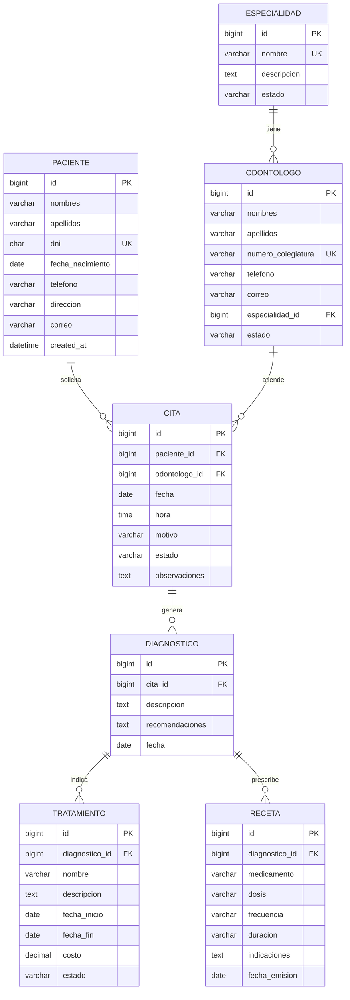

# Sonrisa Perfecta — Sistema de gestión odontológica (Django)

Caso propuesto N.º 01. Python · Django 5.0 · MariaDB · HTML · CSS · JavaScript (sin Bootstrap).

## Funcionalidades

- **7 modelos de negocio**, cada uno en su archivo dentro de `apps/models/`:
  Paciente, Especialidad, Odontologo, Cita, Diagnostico, Tratamiento, Receta.
- **CRUD completo** (registrar, listar, buscar, editar, eliminar) de las 7 tablas, con paginación.
- **Formularios validados** en el servidor (DNI de 8 dígitos, fechas coherentes, horario 08:00–20:00,
  sin citas cruzadas del mismo odontólogo, costo ≥ 0, etc.) y en el navegador (JavaScript).
- **Login** con enlace de registro y checkbox **“Mantener mi cuenta abierta”**
  (marcado: sesión de 14 días; sin marcar: se cierra al cerrar el navegador).
- **Dashboard** con indicadores de pacientes, citas, diagnósticos y tratamientos.
- **Reportes filtrables** (fechas, paciente, odontólogo, estado) de citas, diagnósticos,
  tratamientos y recetas, con **Imprimir / Guardar como PDF** desde el navegador.
- **Seguridad**: variables de entorno (`.env`), CSRF, contraseñas validadas, cookies HttpOnly,
  páginas sin caché, eliminación con `PROTECT` y **permisos por puesto**.

### Roles (se crean automáticamente al ejecutar `migrate`)

| Rol | Puede |
|---|---|
| Administrador | Todo en los 7 módulos |
| Odontologo | Ver pacientes, odontólogos y especialidades; ver/editar citas; CRUD de diagnósticos, tratamientos y recetas |
| Recepcionista | Pacientes y citas; ver odontólogos y especialidades. **No ve datos clínicos** |

Quien se registra recibe el rol **Recepcionista** (nunca `is_staff` ni `is_superuser`).
El administrador cambia roles desde `/admin/` → Usuarios → Grupos.

## Instalación (Windows)

```powershell
# 1. Entorno virtual
python -m venv .venv
.\.venv\Scripts\activate

# 2. Librerías
pip install -r requirements.txt

# 3. Variables de entorno
copy .env.example .env      # luego edite .env con sus datos

# 4. Base de datos: ejecute database\crear_bd.sql como root
#    (phpMyAdmin > pestaña SQL, o por consola):
mysql -u root -p < database\crear_bd.sql

# 5. Tablas, roles y superusuario
python manage.py check
python manage.py migrate
python manage.py createsuperuser

# 6. Servidor
python manage.py runserver
```

Abra <http://127.0.0.1:8000/>. El superusuario entra con todos los permisos.

> **Versión de Django:** se usa Django 5.0 porque XAMPP trae MariaDB 10.4, y Django 5.1/5.2
> exigen MariaDB 10.5 o superior. Si su servidor es MariaDB ≥ 10.5 puede usar
> `pip install "django>=5.2,<5.3"` sin cambiar el código.

Pruebas automáticas: `python manage.py test apps`

Para probar sin MariaDB, ponga `DB_ENGINE=sqlite` en `.env`.

## Diagrama entidad-relación



## Estructura

```
odontologia_django/
├── .env / .env.example / .gitignore / requirements.txt / manage.py / README.md
├── config/            settings.py (lee .env), urls.py, wsgi.py, asgi.py
├── database/          crear_bd.sql
└── apps/
    ├── models/        Paciente.py, Especialidad.py, Odontologo.py, Cita.py,
    │                  Diagnostico.py, Tratamiento.py, Receta.py
    ├── migrations/    0001_initial.py
    ├── validadores.py validaciones reutilizables (DNI, teléfono, nombres)
    ├── apps.py        roles y permisos por puesto
    ├── forms.py       formularios con validaciones
    ├── views.py       login, registro, dashboard, CRUD genérico, reportes
    ├── urls.py        rutas
    ├── admin.py / tests.py
    ├── static/control/css/style.css, js/app.js
    └── templates/control/ base, login, registro, inicio, listado,
                           formulario, reporte, impresion
```

### Rutas principales

| URL | Vista |
|---|---|
| `/login/`, `/registro/` | Autenticación |
| `/` | Dashboard |
| `/<modulo>/` | Listado y búsqueda (`pacientes`, `especialidades`, `odontologos`, `citas`, `diagnosticos`, `tratamientos`, `recetas`) |
| `/<modulo>/nuevo/`, `/<modulo>/<id>/editar/`, `/<modulo>/<id>/eliminar/` | Registrar, editar, eliminar |
| `/reportes/<tipo>/` y `/reportes/<tipo>/imprimir/` | Reporte filtrable y documento para PDF |
